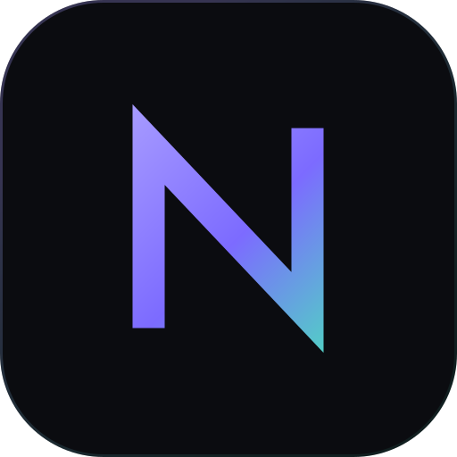

<p align="center">
  
</p>

<h1 align="center">Nexium — Build Smarter. Develop Further.</h1>

<p align="center">
  <strong>One IDE. One editor. One AI Agent. One integrated development experience across programming languages and ecosystems.</strong>
</p>

<p align="center">
  
  
  <a href="https://github.com/GregoryAM-SP/Nexium/issues"></a>
</p>

<p align="center">
  <a href="#download-nexium">Download</a> &nbsp;·&nbsp;
  <a href="#why-nexium">Why Nexium</a> &nbsp;·&nbsp;
  <a href="#whats-inside">What's inside</a> &nbsp;·&nbsp;
  <a href="#installation">Installation</a> &nbsp;·&nbsp;
  <a href="#system-requirements">Requirements</a> &nbsp;·&nbsp;
  <a href="#support">Support</a>
</p>

---

Nexium is an AI-powered desktop IDE built for developers who want their editor, terminal, Git workflow, preview environment, and AI Agent in one focused application. It keeps the files, commands, and context of a project together, so moving between tools no longer means losing the thread.

It is a native desktop workspace for Windows and Linux, designed around real files, real terminals, real Git operations, and a real development server — not a collection of disconnected panels.

## Download Nexium

<p align="center">
  <a href="https://github.com/GregoryAM-SP/Nexium/releases"></a>
  &nbsp;
  <a href="https://nexium.gregoryam.com/nexium-demo.html?scene=workbench"></a>
</p>

Nexium is distributed through the official [GitHub Releases](https://github.com/GregoryAM-SP/Nexium/releases) page. Open the newest published release and choose the package for your platform. The newest version appears first, and every release includes its own notes and platform assets.

| Operating system | Package | Download |
| --- | --- | --- |
| Windows 10/11 (x64) | `.exe` installer | [Latest release](https://github.com/GregoryAM-SP/Nexium/releases) |
| Windows 10/11 (x64) | `.msi` installer | [Latest release](https://github.com/GregoryAM-SP/Nexium/releases) |
| Linux (x64) | `.deb` package | [Latest release](https://github.com/GregoryAM-SP/Nexium/releases) |
| Linux (x64) | `.rpm` package | [Latest release](https://github.com/GregoryAM-SP/Nexium/releases) |
| Linux (x64) | `.AppImage` | [Latest release](https://github.com/GregoryAM-SP/Nexium/releases) |

> **Which package should I choose?**
>
> - **Windows `.exe`** — the straightforward interactive installer. It adds Nexium to the Start menu.
> - **Windows `.msi`** — the Windows Installer package for managed or organization-wide deployments.
> - **Linux `.deb`** — for Debian, Ubuntu, Linux Mint, Pop!_OS, and compatible distributions.
> - **Linux `.rpm`** — for Fedora, RHEL-family distributions, openSUSE, and compatible systems.
> - **Linux `.AppImage`** — a portable build that can run without a system installation.
>
> Files ending in `.sig` are updater signatures, not installers. You do not need to open or run them.

### Latest release

The newest stable build, its release notes, and every platform package are published on GitHub Releases. The application can also check for updates directly from **Settings → Updates**, including the optional pre-release channel.

[Open the latest Nexium release →](https://github.com/GregoryAM-SP/Nexium/releases) &nbsp;·&nbsp; [Browse the complete release history →](https://github.com/GregoryAM-SP/Nexium/releases)

## Why Nexium

### One workspace, one context

Explorer, editor, Agent, terminal, Source Control, and live preview are surfaces of the same application. They share the same workspace root, file watcher, path validation, and theme — so a change made by the Agent, a command run in the terminal, and a diff shown in Source Control all refer to the same project.

### An Agent that works inside the project

The Nexium Agent is file-aware and multi-step. It can inspect the workspace, read and edit files, run commands with your permission, and show its tool activity, timing, and results in the conversation. Each conversation keeps its own provider, configuration, and model, with credentials stored in the operating system credential vault rather than in your project.

### Real operations, not simulated success

Nexium is built around the system's actual tools: the filesystem for project contents, native PTYs for terminals, the Git CLI for Source Control, and real development servers for previews. When something fails, the error is surfaced instead of replaced with a fake success state.

### A serious editor at the center

Monaco provides the editing surface, with tabs, breadcrumbs, find and replace, multi-cursor editing, folding, minimap, project-wide search, session restore, and bundled language workers. TypeScript and JavaScript diagnostics are available in-file, and the workbench includes carefully matched light and dark themes.

### From source to running application

Start the project's own development server and view the result beside the code with responsive device presets. Nexium also understands Flutter web projects, including hot reload and restart, and discovers real Gradle tasks for JVM projects with live terminal output.

### Local-first, account-free

Nexium does not require a Nexium account. Workspace data stays on your machine, Git continues to use your existing credentials, and AI requests go only to the provider and model you configure. No silent provider fallback is used.

## What's inside

| Area | Capabilities |
| --- | --- |
| **Editor** | Monaco editing, multiple tabs, breadcrumbs, TypeScript/JavaScript diagnostics, find and replace, multi-cursor, folding, minimap, and per-workspace session restore. |
| **AI Agent** | Multi-provider and local models, streaming responses, visible tool activity, workspace-aware edits, approved command execution, and external directory grants. |
| **Terminal** | Native PTY sessions, multiple terminal tabs, live output, input and resize propagation, and process cleanup when sessions close. |
| **Source Control** | File-level staging, commits, branches, remotes, history, diffs, tags, fetch, pull, push, and sync status through the system Git CLI. |
| **Search** | Ignore-aware project search with case, whole-word, and regular-expression options; results grouped by file and linked to the matching line. |
| **Preview** | Static sites and framework development servers, responsive viewports, device presets, and Flutter web preview with hot reload and restart. |
| **Gradle** | Real task discovery from the evaluated project model, categories, search, run and stop controls, and live ANSI output in a dedicated terminal session. |
| **Workspace** | Open, create, or clone projects; recent-project history; project templates; resizable layouts; filesystem watching; quick open; and persisted sessions. |
| **Updates** | Update checks through the official GitHub Releases API, signed updater packages, and a selectable stable or pre-release channel. |

Under the workbench: **Tauri 2**, **Rust**, **React 19**, **TypeScript**, **Monaco**, **xterm.js**, and **SQLite**.

## Installation

### Windows

1. Open the newest release on [GitHub Releases](https://github.com/GregoryAM-SP/Nexium/releases).
2. Download either the `.exe` or `.msi` installer for Windows x64.
3. Run the installer, then launch Nexium from the Start menu.

The NSIS `.exe` installer is the simplest option for most users. The `.msi` package is intended for managed deployments through Windows Installer. Windows requires the WebView2 runtime, which ships with current Windows versions.

If Windows displays a security prompt for a newly downloaded application, confirm that the file came from this repository's Releases page before continuing.

### Linux

Nexium's Linux builds target x86_64. Download the package that matches your distribution, then install it with your package manager.

**Debian / Ubuntu**

```bash
sudo apt install ./Nexium*.deb
```

**Fedora / RHEL-family**

```bash
sudo dnf install ./Nexium*.rpm
```

On openSUSE, install the RPM with `zypper` or your desktop's package installer.

**AppImage**

```bash
chmod +x Nexium*.AppImage
./Nexium*.AppImage
```

The AppImage runs without a system installation. If your system cannot run AppImage files, use the `.deb` or `.rpm` package for your distribution instead.

Linux requires a WebKitGTK-based webview and a current graphics stack. Git is required for Source Control, and Gradle Tasks require a compatible JDK plus a project wrapper or local Gradle installation.

### First launch

On the welcome screen you can open an existing folder, create a new project, or clone a Git repository. Nexium remembers recent projects and restores each workspace's open tabs, active file, and layout when you return. No Nexium account is required.

## System requirements

| Platform | Requirements |
| --- | --- |
| **Windows** | Windows 10 or 11, 64-bit; WebView2 runtime. |
| **Linux** | x86_64 distribution with WebKitGTK 4.1 and a current graphics stack. |
| **Source Control** | Git installed and available on `PATH` or in a standard install location. |
| **Gradle Tasks** | A compatible JDK and a Gradle wrapper or local Gradle installation. |
| **AI Agent** | Network access to the provider you configure. An API key is required only when the selected provider requires one. |

macOS builds are not currently distributed. The published installers target Windows x64 and Linux x64.

## Updates and release integrity

Nexium checks the official GitHub Releases API for new versions. Update packages are signed by the release workflow and verified by the application before installation; unsigned updates are refused. Stable and pre-release channels can be selected in **Settings → Updates**, and release notes come directly from the published GitHub release.

You can always install a newer version manually by downloading the current package from [GitHub Releases](https://github.com/GregoryAM-SP/Nexium/releases).

## Support

- **Questions and bug reports:** [open an issue](https://github.com/GregoryAM-SP/Nexium/issues).
- Check the newest release notes and existing issues before opening a new report.
- Include your Nexium version, operating system and package type (`.exe`, `.msi`, `.deb`, `.rpm`, or `.AppImage`), the steps that led to the problem, and what you expected to happen.
- Never include API keys, access tokens, or other secrets in an issue.

## About this repository

This is the **official public distribution repository** for Nexium. It exists to publish release builds, installation packages, updater signatures, and release information.

It is **not** the Nexium source-code repository. The application source, internal build configuration, and development history are maintained separately and are not published here. Cloning this repository does not build the application.

Download Nexium only from this repository's [Releases](https://github.com/GregoryAM-SP/Nexium/releases) page or the official website. Builds published here are produced by the official Nexium release pipeline.

<p align="center">
  <a href="https://nexium.gregoryam.com">Official website</a> &nbsp;·&nbsp;
  <a href="https://nexium.gregoryam.com/features.html">Features</a> &nbsp;·&nbsp;
  <a href="https://nexium.gregoryam.com/downloads.html">Downloads</a> &nbsp;·&nbsp;
  <a href="https://github.com/GregoryAM-SP/Nexium/releases">Releases</a> &nbsp;·&nbsp;
  <a href="https://github.com/GregoryAM-SP/Nexium/issues">Issues</a>
</p>

<p align="center">
  <strong>Nexium — Build Smarter. Develop Further.</strong>
</p>

<p align="center">
  <sub>Windows x64 &nbsp;·&nbsp; Linux x64 &nbsp;·&nbsp; Tauri 2 + Rust</sub>
</p>
 